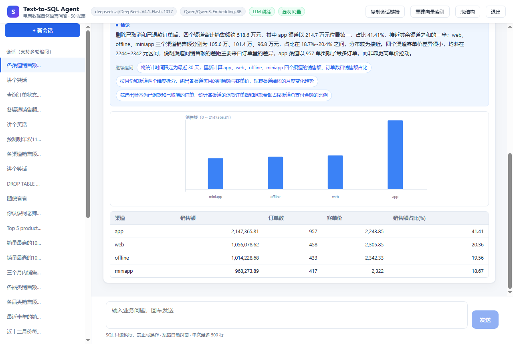

# Text-to-SQL Agent

> 用中文提问，直接得到 SQL、结果表格、图表和一句人话结论。


一个面向真实业务提问的 Text-to-SQL Agent：50 张电商表、多轮追问、SQL 自动纠错、
结果自动解读，并且**默认拒绝**与数据库无关、越权或含糊的问题。



---

## 目录

- [为什么又造一个](#为什么又造一个)
- [特性](#特性)
- [它是怎么工作的](#它是怎么工作的)
- [快速开始](#快速开始)
- [配置](#配置)
- [HTTP API](#http-api)
- [部署](#部署)
- [安全设计](#安全设计)
- [测试](#测试)
- [排错](#排错)
- [目录结构](#目录结构)
- [路线图](#路线图)
- [License](#license)

---

## 为什么又造一个

跑通一个 Text-to-SQL demo 只要半天：把 DDL 塞进 prompt、让模型吐 SQL、执行、渲染表格。
但它离「能给别人用」差着一段距离——模型会答错、会答非所问、会在生成到一半时断掉、
会被一段提示注入骗去删表。这个项目把那段距离补上了，并且把每一步的判断都摆在界面上：

| 常见问题 | 本项目的处理 |
|---|---|
| 50 张表全塞 prompt，又贵又选不准 | 向量检索选 Top6 表，再按外键闭包补齐 JOIN 需要的父表 |
| 生成的 SQL 报错就结束 | 报错、0 行、缺表缺列都作为观察回灌模型重写，带硬预算 |
| 只给一张表，用户还得自己读 | 自动生成中文结论 + 可点击的下钻追问 |
| 问「讲个笑话」也硬凑一条 SQL | 规则前置 + 模型协议双层拒答，并给出**能问什么** |
| 生成到一半切走，回来啥都没了 | 结果先落库再推送，断连自动补偿 |

## 特性

**问答链路**

- **中文优先**：所有模型调用统一注入语言规则，即使英文提问、字段值是英文，结论与追问也是中文
- **多轮追问**：「那按月份呢」「只看广东」会带上上一轮 SQL 与结论做指代消解
- **结果自动解读**：默认免点击生成结论，含关键数字与占比；可「重新解读」
- **追问建议**：基于当前 SQL 给出时间/维度/筛选三个方向的下钻问题，点击即在同会话继续
- **检索可视化**：展示本轮命中的表、中文名、向量分与关键词分，选表不再是黑盒

**正确性**

- **SQL 自动纠错**：执行报错、返回 0 行、缺表缺列，都会触发一次带观察的重写
- **只读闸门**：剥离字符串字面量后校验关键字与多语句，强制顶层 `LIMIT`，5s 超时，`mode=ro`
- **拒答与引导**：无关（闲聊、创作、实时股价）、越权（写操作、索要密钥、提示注入）、
  模糊（缺指标/维度）的问题不硬凑 SQL，而是说明原因并给出可点击的正确问法
- **业务口径**：GMV、有效订单、销量等定义固化进 system prompt，减少口径幻觉

**可用性**

- **会话完整还原**：切走再切回，表格、图表、结论、命中表全部还原；旧会话自动补全且不消耗额度
- **SQL 可编辑**：生成结果可复制、手工改、一键重跑，重跑仍受只读闸门约束
- **流可控**：可「停止生成」，切换会话自动取消在途请求，SSE 带心跳
- **分享**：当前会话写入 URL `?s=<id>`，刷新自动恢复，可一键复制会话链接
- **移动端**：窄屏下侧栏与表结构面板变抽屉，图表自动缩减数据点，输入框适配 iOS 安全区

**工程**

- 单进程部署：前端构建产物由后端托管，不需要额外起一个 Node 服务
- 应用层登录：中文登录页 + HMAC token（绑定密码版本，改密即失效）+ 按 IP 限流
- 零额度自测：`MOCK_MODE=true` 下用本地伪向量与规则 SQL 跑完整链路，不调用任何外部 API

## 它是怎么工作的

```
               ┌────────────────────────────── 用户提问 ──────────────────────────────┐
               │                                                                      │
               ▼                                                                      │
   ⓪ 护栏（规则前置）  ── 明显无关/越权/注入 ──▶ 拒答 + 可点击的正确问法（0 次模型调用）│
               │ 通过                                                                  │
               ▼                                                                      │
   ① 问题向量化  Qwen3-Embedding-8B                                                     │
               ▼                                                                      │
   ② Schema Linking  向量 + 中文关键词融合 → Top6 表 → 外键闭包补全（多轮继承上轮表）  │
               ▼                                                                      │
   ③ 上下文组装  DDL + 中文列说明 + 枚举值 + 样例行 + 业务口径 + few-shot + 历史对话    │
               ▼                                                                      │
   ④ SQL 生成  DeepSeek-V4.1-Flash（只允许输出一条 SELECT；无法回答时走【拒答】协议）  │
               ▼                                                                      │
   ⑤ 只读闸门  剥离字面量 → 关键字/注释/多语句校验 → 顶层 LIMIT → 超时保护             │
               │                                                                      │
               ├─ 报错 / 0 行 / 缺表 ──▶ ⑥ ReAct 回灌重写（受 MAX_LLM_CALLS 硬预算）──┘
               ▼ 成功
   ⑦ 先落库（user + assistant 同事务）→ 再推 SSE：tables → sql → result → insight
               ▼
   ⑧ 表格 / SVG 图表（截断标记、负值基线、窄屏自适应）+ 自动中文结论 + 追问建议
               ▼
   ⑨ 结论 patch 回同一条消息；成功问答向量化入 few-shot 库（带表名白名单与保留上限）
```

### 技术选型

| 层 | 选型 | 说明 |
|---|---|---|
| 文本模型 | `deepseek-ai/DeepSeek-V4.1-Flash-1017`（魔搭 ModelScope） | OpenAI 兼容接口，有免费额度，可换成任意兼容实现 |
| 向量模型 | `Qwen/Qwen3-Embedding-8B`（硅基流动，1024 维） | 只用于 50 张表的 schema linking 与 few-shot 检索 |
| 数据库 | SQLite | 自建 50 张电商表、51,899 行关联一致的模拟数据 |
| 后端 | FastAPI + SSE | 单一进程同时提供 API 与静态前端 |
| 前端 | Vue 3 + Vite | 无 UI 框架依赖，图表用原生 SVG 手绘 |

> 说明：默认模型 ID 带 `-1017` 后缀，厂商会下线旧版本。换模型只需改 `.env` 里的
> `LLM_MODEL` / `EMB_MODEL`，任何 OpenAI 兼容端点都能接。

## 快速开始

### 环境要求

- Python 3.11+（推荐 3.12）
- Node.js 18+（只在需要改前端时需要，仓库不含构建产物）
- 两个 API Key：文本模型、embedding 模型（或先开 `MOCK_MODE` 零额度体验）

### 三步跑起来

```bash
git clone https://github.com/standbyme626/text2sql-agent.git
cd text2sql-agent

# 1) 配置密钥（.env 已被 .gitignore 忽略）
cp .env.example .env
#    MODELSCOPE_API_KEY=ms-xxx      魔搭 → 头像 → 访问令牌
#    SILICONFLOW_API_KEY=sk-xxx     硅基流动控制台

# 2) 一键装依赖 + 建库 + 建索引 + 启动
bash run.sh          # Windows 双击 run.bat
```

浏览器打开 **http://127.0.0.1:3388**。本机模式未设 `AUTH_PASSWORD` 时免登录。

> **只想看界面、不消耗任何额度**：在 `.env` 里设 `MOCK_MODE=true`，
> 用本地伪向量与规则 SQL 跑完整链路（页面会明确标注是 Mock 模式）。

### 分步执行

```bash
python -m venv .venv
.venv/bin/pip install -r backend/requirements.txt
.venv/bin/python backend/scripts/init_db.py        # 建 50 张表 + 模拟数据
cp .env.example .env                               # 填 key
.venv/bin/python backend/scripts/build_index.py    # 建向量索引（约 1 次 embedding 调用）
.venv/bin/python -m uvicorn app.main:app --app-dir backend --host 127.0.0.1 --port 3388
```

前端源码在 `frontend/`，构建后会拷进 `backend/static/` 由后端托管：

```bash
cd frontend && npm install && npm run build && cd ..
rm -rf backend/static/* && cp -r frontend/dist/. backend/static/
```

### Docker

```bash
cp .env.example .env      # 填 key；容器内 HOST 固定为 0.0.0.0
docker compose up -d --build
```

首次启动会自动建库。容器**只映射到宿主机 `127.0.0.1:3388`**，公网入口交给反代（见[部署](#部署)）。

## 配置

所有配置来自项目根 `.env`，密钥不落代码、不进版本库。常用项：

| 变量 | 默认值 | 说明 |
|---|---|---|
| `HOST` / `PORT` | `127.0.0.1` / `3388` | 监听地址与端口 |
| `AUTH_USER` / `AUTH_PASSWORD` | `admin` / 空 | **公网部署必填**；为空时服务拒绝以非回环地址启动 |
| `TOKEN_TTL_HOURS` | `24` | 登录 token 有效期 |
| `MODELSCOPE_API_KEY` | 空 | 文本模型 key |
| `LLM_MODEL` | `deepseek-ai/DeepSeek-V4.1-Flash-1017` | 任意 OpenAI 兼容模型 ID |
| `SILICONFLOW_API_KEY` | 空 | embedding key，缺失时自动降级关键词选表 |
| `EMB_MODEL` / `EMB_DIM` | `Qwen/Qwen3-Embedding-8B` / `1024` | 向量模型与维度 |
| `TOP_K_TABLES` | `6` | 每轮选表数，再按外键补 `FK_EXPAND_MAX` 张 |
| `MAX_SQL_RETRY` | `2` | SQL 报错自动纠错次数 |
| `MAX_LLM_CALLS` | `5` | 单轮 LLM 硬预算，防止重试叠加烧额度 |
| `MAX_RESULT_ROWS` | `500` | 单次返回行数上限，超出会标记截断 |
| `AUTO_INSIGHT` / `FOLLOWUP_COUNT` | `true` / `3` | 自动结论与追问条数 |
| `EMPTY_RESULT_RETRY` | `true` | 0 行结果回灌放宽条件重试一次 |
| `GUARD_ENABLED` / `GUARD_SUGGESTIONS` | `true` / `3` | 拒答护栏与引导问法条数 |
| `RATE_LIMIT_ENABLED` / `RATE_LIMIT_PER_MIN` | `true` / `40` | 高消耗端点限流 |
| `CORS_ORIGINS` | 空（同源） | 生产环境写站点域名，不默认放开 `*` |
| `MOCK_MODE` | `false` | 零外部调用自测 |
| `ALLOW_INSECURE` | `0` | 跳过「必须鉴权」检查，**仅容器内网调试用** |

完整清单与注释见 [`.env.example`](.env.example)。所有次数/上限类配置都会被自动钳制到安全区间，写错不会失控。

**额度**：一次提问通常是 2 次 LLM 调用（生成 SQL + 洞察）+ 1 次 embedding；
纠错/空结果/扩表重试各 +1，但受 `MAX_LLM_CALLS` 约束。想省额度可设 `AUTO_INSIGHT=false`，
前端会显示「自动结论已关闭」并提供手动解读。

## HTTP API

除 `/api/health`、`/api/login` 外，其余端点都需要请求头 `X-App-Token: <token>`。

| 方法 | 路径 | 说明 |
|---|---|---|
| `GET` | `/api/health` | 存活探针，仅返回 `ok` 与 `auth_enabled` |
| `POST` | `/api/login` | `{username,password}` → `{token,expires_at}` |
| `POST` | `/api/logout` | 撤销当前 token |
| `GET` | `/api/status` | 登录后的详细状态：选表模式、索引错误、模型就绪度 |
| `GET` | `/api/meta` | 50 张表的元信息（中文名、业务域、行数） |
| `GET` | `/api/tables/{name}` | 单表 DDL、字段说明、枚举值、样例行 |
| `POST` | `/api/query` | **SSE 流式问答**，见下 |
| `POST` | `/api/sql` | 用户编辑后重跑 SQL（仍受只读闸门约束，结果回写会话） |
| `POST` | `/api/explain` | 对已有结果重新生成结论 |
| `GET` | `/api/sessions` | 当前身份的会话列表 |
| `GET` | `/api/history?session_id=` | 会话完整消息（含表格/图表/结论的原始载荷） |
| `DELETE` | `/api/sessions/{id}` | 删除会话并级联清理 few-shot |
| `POST` | `/api/index/rebuild` | 重建向量索引（带冷却与并发锁） |

`POST /api/query` 的 SSE 事件序列：

| 事件 | 载荷 | 说明 |
|---|---|---|
| `session` | `{session_id}` | 新会话时下发 |
| `stage` | `{stage}` | 进度：选表 / 生成 SQL / 执行 / 解读 |
| `tables` | `{tables:[{name,cn,score,keyword_score}]}` | 本轮命中表 |
| `sql` | `{sql}` | 通过闸门、即将执行的 SQL |
| `result` | `{columns,rows,truncated,ms,chart}` | 结果集与图表建议 |
| `retry` | `{attempt,reason}` | 触发了一次自纠正 |
| `insight` | `{summary,followups}` | 自动结论与追问 |
| `guidance` | `{reason,suggestions}` | 拒答与正确问法 |
| `error` | `{message}` | 已脱敏的失败原因 |
| `done` | `{message_id}` | 结束，前端据此收尾 |

```bash
TOKEN=$(curl -s -X POST http://127.0.0.1:3388/api/login \
  -H 'Content-Type: application/json' \
  -d '{"username":"admin","password":"***"}' | jq -r .token)

curl -N -X POST http://127.0.0.1:3388/api/query \
  -H "X-App-Token: $TOKEN" -H 'Content-Type: application/json' \
  -d '{"question":"各渠道销售额占比","session_id":null}'
```

## 部署

### 方式一：本机 / 单机

`run.sh` 起在 `127.0.0.1:3388`，用 nginx / Caddy 反代即可。**反代必须关掉响应缓冲**，
否则 SSE 会被攒成一次性返回：

```nginx
location / {
    proxy_pass http://127.0.0.1:3388;
    proxy_http_version 1.1;
    proxy_set_header Host $host;
    proxy_set_header X-Forwarded-For $remote_addr;   # 覆盖，防止伪造 IP 绕过限流
    proxy_buffering off;                              # SSE 必须
    proxy_read_timeout 300s;
}
```

### 方式二：内网机器 + 公网反代机（SSH 反向隧道）

没有公网 IP 的家用/办公服务器也能上线，且**不开放任何入站端口**：

```
浏览器 → 公网反代机 nginx:443 → 127.0.0.1:3388（SSH 反向隧道）→ 内网应用机 FastAPI
```

`deploy/` 提供了整套模板：

| 文件 | 用途 |
|---|---|
| `text2sql.service` | 应用侧 systemd 单元（低权限用户 + 重启速率限制） |
| `text2sql-tunnel.service` | SSH 反向隧道常驻单元 |
| `text2sql-watchdog.{service,timer}` | 每 2 分钟探活，服务或隧道挂了自动重启 |
| `prepare-user.sh` | 建低权限账号并迁移权限 |
| `nginx-bootstrap.conf` / `nginx-site.conf` | 首签证书用的 80 模板 / 最终 443 反代模板 |
| `setup-edge.sh` | 反代机一键上线：签发证书 → 覆盖配置 → 改续期方式 → 断言 401/200 |
| `fix-renewal.py` | 把 certbot 续期改成 `webroot + installer=None`，避免改写手工配置 |
| `gen_env.sh` | 从本机凭据文件注入 key 到 `.env`，值不回显 |

```bash
# 应用侧
sudo PROJ=/opt/text2sql-agent bash deploy/prepare-user.sh
sudo cp deploy/text2sql.service deploy/text2sql-tunnel.service /etc/systemd/system/
sudo systemctl daemon-reload && sudo systemctl enable --now text2sql text2sql-tunnel

# 反代机
DOMAIN=sql.example.com sudo -E bash /tmp/text2sql-deploy/setup-edge.sh
```

几个必须知道的点：

- `ssh -R` 的目标要写 `127.0.0.1`，写 `localhost` 可能解析到 `::1` 导致只监听单栈
- 隧道方案下「公网可达」与 `HOST` 无关，所以**未设 `AUTH_PASSWORD` 时服务拒绝启动**
- `proxy_buffering off` 丢了 SSE 就变成一次性返回，是排查「流式失效」的第一现场

## 安全设计

| 面 | 做法 |
|---|---|
| 认证 | 应用层登录页 + HMAC token（`X-App-Token`），签名绑定密码版本，改密/轮换 `SECRET_KEY` 后旧 token 立即失效 |
| 限流 | 登录失败按 IP 计数并封禁；高消耗端点按 token+IP 滑动窗口；只信任反代覆盖后的远端 IP |
| 只读 | 剥离字符串字面量后校验；单语句；强制顶层 `LIMIT`；5s 超时；连接 `mode=ro` + `PRAGMA query_only=ON` |
| 越权 | 拦截写操作、`PRAGMA`/`ATTACH`/`VACUUM`、`randomblob` 资源耗尽、提示注入变体 |
| 数据隔离 | 会话绑定登录身份，列表/历史/删除均按 owner 过滤 |
| 静态资源 | SPA 兜底路径做 `resolve()` 前缀校验，杜绝 `../` 读到 `.env` / `.secret_key` |
| 错误 | 异常类名、SQLite 报错、上游响应正文只进服务端日志；客户端只见稳定文案 |
| 密钥 | 仅 `.env`（600），数据目录 0700，`.secret_key` 用 `O_EXCL` 原子创建；不进 Git、不打进镜像、不写日志 |

> ⚠️ 把带执行能力的服务挂到公网前，请至少确认三件事：有认证、有出站/入站限制、
> 有日志与告警。无鉴权的公网 Web 服务被扫描器打穿只是时间问题。

## 测试

```bash
# 90 项断言，跑在独立临时数据目录，零外部 API 消耗
MOCK_MODE=true .venv/bin/python backend/scripts/selftest.py
```

覆盖鉴权与限流、只读闸门（合法放行 / 写操作拦截）、护栏（易误伤语料必须放行、
注入必须拦截）、会话还原、老库幂等迁移、LLM 超时与 429 的重试策略。
详见 [`docs/ENGINEERING-NOTES.md`](docs/ENGINEERING-NOTES.md)。

## 排错

| 现象 | 处理 |
|---|---|
| 启动报「未配置 AUTH_PASSWORD」 | 非回环地址必须鉴权；本机调试设 `HOST=127.0.0.1` 或容器调试显式 `ALLOW_INSECURE=1` |
| 选表模式显示「关键词」 | 未建或索引损坏；`/api/status` 的 `index_error` 有原因，可点「重建向量索引」 |
| 上游 429 | 免费额度到顶；程序已做 3s/6s/12s 退避，可换模型或等额度重置 |
| 模型返回空内容 | DeepSeek 是推理模型，代码会回落读 `reasoning_content`；仍为空则走 `insight_warning` |
| 页面提示「前端尚未构建」 | `cd frontend && npm install && npm run build`，再把 `dist/` 拷进 `backend/static/` |
| 生成卡住不动 | 点「停止生成」；后端每 15s 发心跳，前端 4 分钟超时 |
| SSE 一次性返回全部内容 | 反代开了缓冲，检查 `proxy_buffering off` |
| SQL 被拒 | 页面会显示原因；只读闸门拦截写操作与嵌套限制，可在 SQL 块里手工改后重跑 |

## 目录结构

```
text2sql-agent/
├── backend/
│   ├── app/
│   │   ├── main.py            # 路由、SSE、静态托管、错误脱敏
│   │   ├── agent.py           # Agent 编排：选表 → 生成 → 纠错 → 落库 → 推送
│   │   ├── guard.py           # 异常问题拒答与引导
│   │   ├── db.py              # 只读执行器、LIMIT 注入、截断判定、图表建议
│   │   ├── llm.py             # OpenAI 兼容客户端 + SQL 提取
│   │   ├── embedding.py       # 向量模型客户端
│   │   ├── schema_index.py    # 向量选表 + 关键词降级
│   │   ├── store.py           # 会话/消息/幂等迁移/few-shot 库
│   │   ├── auth.py            # HMAC token 与限流
│   │   ├── config.py          # 全部配置，只从 .env 读
│   │   └── models.py          # 请求体校验
│   ├── scripts/
│   │   ├── schema.py          # 50 张表定义（含中文注释）
│   │   ├── init_db.py         # 建库 + 模拟数据
│   │   ├── build_index.py     # 构建向量索引
│   │   └── selftest.py        # 90 项全链路自测
│   └── data/                  # 运行期数据（已忽略，首次启动生成）
├── frontend/src/              # Vue 3 源码
├── deploy/                    # systemd / nginx / 隧道 / 证书 / 私有云上线脚本
├── docs/
│   ├── ENGINEERING-NOTES.md   # 设计取舍、30 项加固清单、自测矩阵
│   └── screenshots/
├── Dockerfile / docker-compose.yml
├── run.sh / run.bat           # 一键启动
└── .env.example
```

## 路线图

- [ ] 接入 Postgres / MySQL，按方言切换只读规则
- [ ] 语义层（指标口径 YAML）替代自由文本业务口径
- [ ] 千表规模的分层检索（先选业务域，再选表）
- [ ] 结果集的增量对比（同名查询跑两次看变化）

## License

[MIT](LICENSE)
