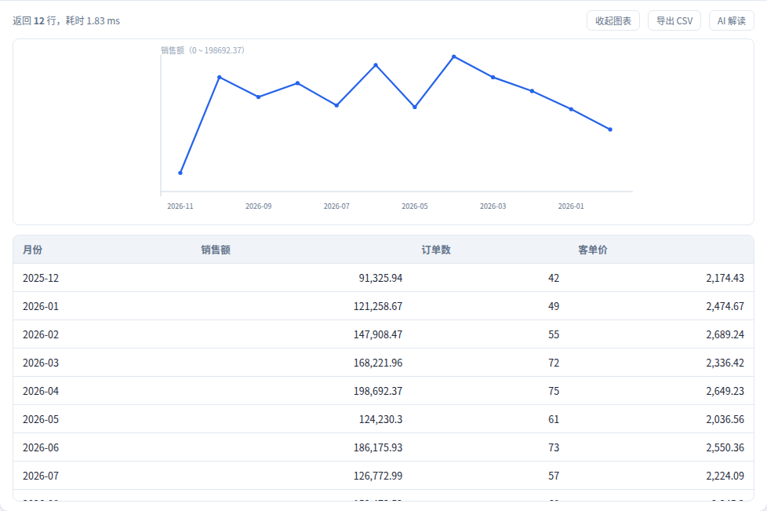
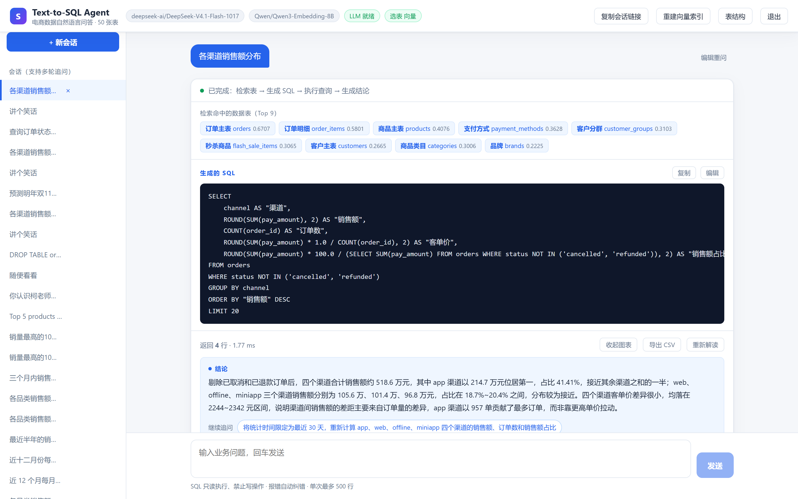
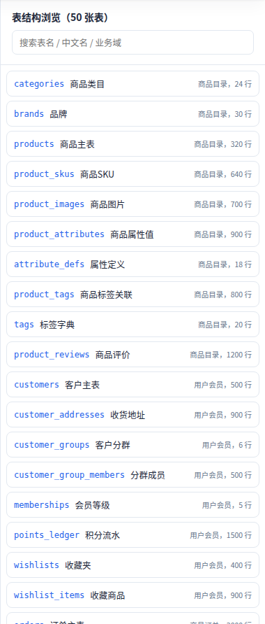
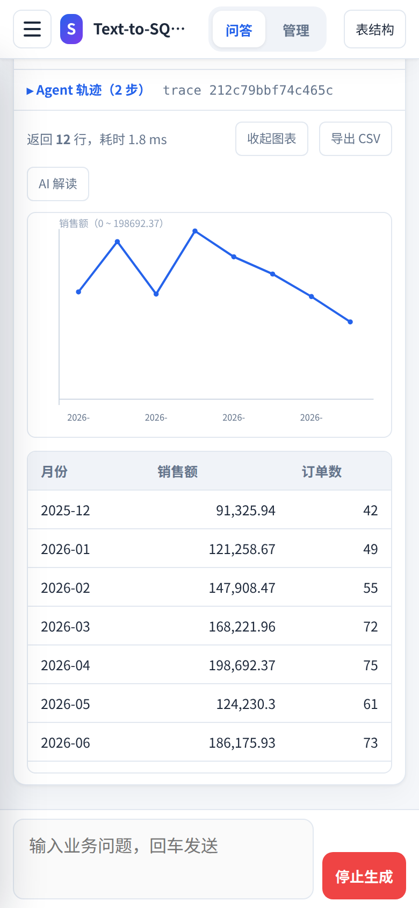
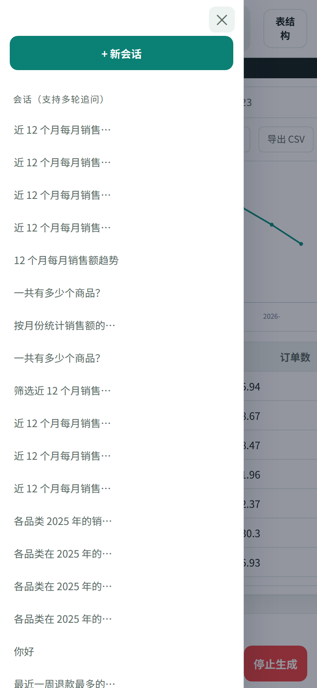
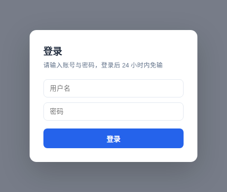

<div align="center">

# text2sql-agent

**面向电商数据集的中文 Text-to-SQL Agent**

向量选表 · 只读闸门 · ReAct 自纠正 · 拒答引导 · SSE 流式 · 可审计


[项目概览](#1-项目概览) · [核心特性](#2-核心特性) · [界面](#3-界面) · [系统架构](#4-系统架构) · [快速开始](#8-快速开始) · [API](#9-api)

[部署](#10-部署) · [测试与验证](#11-测试与验证) · [已知限制](#12-已知限制与未验证事项) · [踩坑记录](#13-工程实践与踩坑) · [Roadmap](#16-roadmap)

</div>

> **项目状态：可运行 / 单实例演示。**
> 曾在公网域名上以「应用层登录 + 只读闸门」对外提供过一段时间，单账号使用；
> 仓库不含数据库文件、向量索引与任何密钥，首次运行按第 8 节初始化，约 1 分钟建好 50 张表。

**50 张表** · **51,899 行** · **Top-6 向量选表** · **90 项自测** · **单轮 ≤ 5 次 LLM 调用**

---

## 目录

- [1. 项目概览](#1-项目概览)
- [2. 核心特性](#2-核心特性)
- [3. 界面](#3-界面)
- [4. 系统架构](#4-系统架构)
- [5. 选表与生成](#5-选表与生成)
- [6. 只读闸门与拒答](#6-只读闸门与拒答)
- [7. 数据资产](#7-数据资产)
- [8. 快速开始](#8-快速开始)
- [9. API](#9-api)
- [10. 部署](#10-部署)
- [11. 测试与验证](#11-测试与验证)
- [12. 已知限制与未验证事项](#12-已知限制与未验证事项)
- [13. 工程实践与踩坑](#13-工程实践与踩坑)
- [14. 目录结构](#14-目录结构)
- [15. 安全须知](#15-安全须知)
- [16. Roadmap](#16-roadmap)

---

## 1. 项目概览

### 1.1 要解决的问题

Text-to-SQL 的 demo 半天能写完，但它离「能给别人用」差一段距离：

- **50 张表的 DDL 不能全塞进 prompt**：约 3 万 token，又贵又选不准；
- **模型生成的 SQL 会报错**：语法错、字段错、JOIN 漏表，直接把错误抛给用户等于没做；
- **用户看不懂结果表**：需要一句人话结论，以及下一步该问什么；
- **什么都能问 = 什么都答不好**：「讲个笑话」「DROP TABLE」这类输入必须被挡住，
  并告诉用户**能问什么**；
- **生成到一半断掉会丢数据**：SSE 断开时若先推送后落库，历史里只剩半条消息。

### 1.2 方案

采用 **固定主链路 + 局部 ReAct 循环**：

- 主链路固定：选表 → 生成 → 校验 → 执行 → 解读，保证每一步可观测、可回放；
- 局部保留 Agent 自主性：只在「报错 / 0 行 / 缺表缺列」时把 Observation 回灌重写，且有硬预算；
- 选表用向量检索，但**必须能降级**：没 key、429、索引损坏时退回中文关键词匹配；
- 拒答分两层：规则前置拦截零成本，模型协议处理模糊问题。

### 1.3 六个平面

| 平面 | 职责 | 入口 |
|---|---|---|
| 策略 | 配置快照、次数上限钳制、鉴权开关 | `config.py` |
| 执行 | Agent 编排、上下文组装、自纠正循环 | `agent.py` |
| 治理 | 只读闸门、拒答护栏、限流 | `db.py` / `guard.py` / `auth.py` |
| 数据 | 50 表 schema、向量索引、会话与 few-shot | `schema_index.py` / `store.py` |
| 观测 | SSE 阶段事件、`/api/status`、错误脱敏 | `main.py` |
| 交互 | 会话、SQL 编辑重跑、图表、移动端 | `frontend/src/` |

---

## 2. 核心特性

| 能力 | 代码入口 |
|---|---|
| **向量选表** — 问题向量化 → Top-6 表；中文关键词融合打分兜底 | `schema_index.py::search`、`keyword_score` |
| **外键闭包补表** — 缺 JOIN 父表时按 `fks` 补全，最多 `FK_EXPAND_MAX` 张 | `schema_index.py::expand_with_fks` |
| **上下文组装** — DDL + 中文列说明 + 枚举值 + 样例行 + 业务口径 + few-shot + 交替历史 | `prompt_context`、`build_messages` |
| **SQL 生成** — 只允许一条 SELECT；无法回答时走 `【拒答】原因｜建议` 协议 | `llm.py::chat`、`extract_sql` |
| **只读闸门** — 剥离字面量后校验关键字/注释/多语句；强制顶层 LIMIT；5s 超时 | `db.py::clean_sql`、`_top_level_limit` |
| **ReAct 自纠正** — 报错 / 0 行 / 缺表缺列作为 Observation 回灌；单轮 LLM 硬预算 | `agent.py::run_agent` |
| **自动解读** — 结论 + 追问合并为 1 次轻量调用，只喂前 8 行；0 行/截断走专用提示 | `agent.py::build_insight` |
| **拒答引导** — 规则前置拦截无关/越权/注入；模糊问题给可点击的正确问法 | `guard.py::check`、`parse_refusal` |
| **会话还原** — 完整回答结构化落库（`payload`），切走再切回表格/图表/结论都在 | `store.py::add_answer`、`get_history` |
| **鉴权** — 中文登录页 + HMAC token，签名绑定密码版本；登录失败按 IP 限流 | `auth.py::make_token`、`rate_ok` |
| **流式输出** — SSE 十种事件：`session` / `stage` / `tables` / `sql` / `result` / `retry` / `insight` / `guidance` / `error` / `done` | `main.py::query`、`agent.py` |
| **前端** — Vue 3 单页，无 UI 框架，图表用原生 SVG 手绘 | `frontend/src/components/` |

---

## 3. 界面

<p align="center">
  
</p>

<p align="center"><sub>自动结论 + 可点击追问 + 图表 + 表格；右上角可收起图表、导出 CSV、重新解读</sub></p>

**Agent 过程是可见的**：本轮命中了哪几张表、各自的向量分/关键词分、最终执行的 SQL，
都摆在结果前面，不是黑盒。

<p align="center">
  
</p>

<p align="center"><sub>检索命中的数据表（Top 9，含分数）+ 生成的 SQL（可复制、可编辑后重跑）</sub></p>

**异常问题不会硬凑 SQL**，而是说明原因并给出可以直接点的问法：

<p align="center">
  
</p>

<p align="center"><sub>规则前置拦截「讲个笑话」，零模型消耗；建议问法点击即问</sub></p>

**表结构可浏览**：50 张表按名称/中文名/业务域搜索，展开看 DDL、字段中文说明、枚举值、样例行。

<p align="center">
  
</p>

<p align="center"><sub>右侧为表结构面板，左侧会话不受影响</sub></p>

**移动端**：侧栏与表结构面板变抽屉，图表自动缩减数据点，输入框适配 iOS 安全区。

<table align="center">
  <tr>
    <td align="center"></td>
    <td align="center"></td>
  </tr>
  <tr>
    <td align="center"><sub>结果区（390×844）</sub></td>
    <td align="center"><sub>侧栏抽屉</sub></td>
  </tr>
</table>

**公网部署时走应用层登录**，不依赖 nginx Basic（原生 401 弹窗在手机和预览面板里常不出现）：

<p align="center">
  
</p>

<p align="center"><sub>登录后 24 小时内免输；token 绑定密码版本，改密即失效</sub></p>

---

## 4. 系统架构

### 4.1 总览

```text
用户提问（中文）
   │
   ▼
①  guard.check ─────── 无关 / 越权 / 注入 ──▶ guidance（0 次模型调用）
   │ 通过
   ▼
②  embed(question) ──▶ Qwen3-Embedding-8B（1024 维）
   │                    └─ 失败则降级：中文关键词选表
   ▼
③  SchemaIndex.search ──▶ Top-6 表
   └─ expand_with_fks ──▶ 外键闭包补齐 JOIN 父表
   ▼
④  prompt_context ──▶ DDL / 列中文名 / 枚举值 / 样例行 / 业务口径
   └─ store.similar ──▶ few-shot（按表名白名单过滤）
   ▼
⑤  llm.chat ──▶ 一条 SELECT（或【拒答】原因｜建议）
   ▼
⑥  clean_sql 只读闸门 ──▶ execute_readonly（mode=ro + query_only + 5s）
   │  报错 / 0 行 / 缺表缺列
   └──────────▶ 作为 Observation 回灌重写（≤ MAX_LLM_CALLS）
   ▼
⑦  先落库：user + assistant 同事务（payload 存完整回答）
   ▼
⑧  build_insight ──▶ 中文结论 + 3 条追问
   ▼
⑨  SSE 推送：session → stage → tables → sql → result → insight → done
```

### 4.2 一次提问的完整过程

1. 前端 `POST /api/query`，建立 SSE 连接，携带 `X-App-Token`；
2. `guard.check` 做规则前置：命中写操作、注入、闲聊直接返回 `guidance`，**不调用任何模型**；
3. `embedding.embed_one` 把问题向量化（失败则降级为关键词选表）；
4. `SchemaIndex.search` 融合向量分与中文关键词分取 Top-6，再按外键补全 JOIN 父表；
5. `prompt_context` 组装 DDL、列中文名、枚举值、样例行、业务口径，`store.similar` 补 few-shot；
6. `llm.chat` 生成 SQL，`extract_sql` 只取第一条 SELECT；
7. `db.clean_sql` 剥离字面量后校验，注入顶层 LIMIT，`execute_readonly` 以 `mode=ro` 执行；
8. 失败或 0 行时把错误作为 Observation 回灌重写（受 `MAX_SQL_RETRY` 与 `MAX_LLM_CALLS` 双重约束）；
9. **先落库**：`store.add_answer` 把 SQL、结果、命中表、图表建议写进同一条 assistant 消息；
10. `build_insight` 生成中文结论与追问，patch 回该消息，再推 `insight` 事件；
11. 成功问答向量化写入 `qa_history` 作为后续 few-shot（带会话归属、表名白名单、保留上限）。

### 4.3 数据平面

| 存储 | 职责 | 说明 |
|---|---|---|
| `ecommerce.db` | 50 张电商演示表 | 首次运行由 `scripts/init_db.py` 生成，约 3.7 MB / 51,899 行 |
| `app.db` | 会话、消息、few-shot 库 | WAL 模式；`messages.payload` 存完整回答 |
| `schema_meta.json` | 表中文名、业务域、列说明、枚举值 | 建库时一并生成，选表与上下文都依赖它 |
| `schema_index.json` | 50 条表描述向量 | `scripts/build_index.py` 生成，可重建 |
| `.secret_key` | token 签名密钥 | 首次启动 `O_EXCL` 原子创建，权限 600 |

### 4.4 模型供给

- **文本**：`deepseek-ai/DeepSeek-V4.1-Flash-1017`（魔搭 ModelScope，OpenAI 兼容）；
- **向量**：`Qwen/Qwen3-Embedding-8B`（硅基流动，1024 维），只用于选表与 few-shot 检索；
- **可替换**：两个端点都是 OpenAI 兼容协议，改 `.env` 的 `LLM_BASE_URL` / `LLM_MODEL` 即可换成别家；
- **降级顺序**：向量选表 → 关键词选表；自动结论失败 → 前端提示可手动「AI 解读」；无 Key → `MOCK_MODE`。

---

## 5. 选表与生成

### 5.1 为什么不把 DDL 全塞进去

50 张表的建表语句 + 中文注释约 3 万 token。按轮次拼进去的后果是：贵、慢，而且**准确率反而下降**
（模型会挑错表、拼错 JOIN）。向量选表把每轮上下文压到 6 张表以内，同时保留业务语义：

| 用户问法 | 命中的表 | 靠什么命中 |
|---|---|---|
| 「各渠道销售额占比」 | `orders`、`order_items`、`payment_methods` | 语义「销售额 / 渠道」 |
| 「哪些商品库存低于安全库存」 | `products`、`inventory`、`warehouses` | 关键词「库存 / 安全库存」 |
| 「近三个月复购率」 | `orders`、`customers`、`customer_groups` | 语义 + 外键闭包引入 `customers` |

### 5.2 外键闭包

Top-6 只按语义选出，很容易漏掉 JOIN 需要的维表。`expand_with_fks` 会读每张表的 `fks`，
把父表补进来（最多 `FK_EXPAND_MAX` 张），避免模型写出「`orders JOIN customers` 但 `customers` 不在上下文里」。

### 5.3 自纠正循环

```text
生成 SQL → 执行
   ├─ SQL 语法/字段错误 ──▶ 把 sqlite 报错原文作为 Observation 回灌 → 重写
   ├─ 返回 0 行        ──▶ 提示「可能是过滤条件过严」，放宽后重试一次
   ├─ no such table    ──▶ 扩表重检索（新 Top-K）后重写
   └─ 成功            ──▶ 落库 + 解读
```

三重约束防止失控：`MAX_SQL_RETRY=2`（最多 3 次生成）、`MAX_LLM_CALLS=5`（单轮硬预算）、
**429/超时不进「改 SQL」重试**（重试也不会成功，只会白烧额度）。

### 5.4 可调参数

| 参数 | 默认 | 位置 |
|---|---|---|
| `TOP_K_TABLES` | 6 | `.env` / `config.py` |
| `FK_EXPAND_MAX` | 3 | 同上，外键闭包最多补几张 |
| `FEWSHOT_K` | 2 | 注入几条相似历史问答 |
| `MAX_SQL_RETRY` | 2 | 报错重写次数（钳制 0~5） |
| `MAX_LLM_CALLS` | 5 | 单轮 LLM 调用硬预算（钳制 1~20） |
| `MAX_RESULT_ROWS` | 500 | 单次返回上限，超出标记 `truncated` |
| `SQL_TIMEOUT_MS` | 5000 | 单条 SQL 超时 |
| `EMPTY_RESULT_RETRY` | `true` | 0 行是否回灌重试 |
| `HISTORY_TURNS` | 6 | 注入几轮历史对话 |

---

## 6. 只读闸门与拒答

### 6.1 三道闸门

```text
① 应用层文本校验    剥离字符串字面量与注释 → 关键字 / 多语句 / 顶层 LIMIT
② 连接级只读        sqlite3 以 mode=ro 打开 + PRAGMA query_only=ON
③ 执行级兜底        5s 超时 + fetchmany(limit+1) 判截断
```

第 ① 道是踩坑改出来的。最初对**整条 SQL** 做关键字扫描，结果：

- `SELECT REPLACE(name,'旧','新') FROM product` —— `replace` 是**函数名**，被当成写操作拒掉；
- `WHERE name LIKE '%a;b%'` —— 字符串里的分号被判成多语句。

现在先把字符串常量和 `--` / `/* */` 注释替换成占位符再校验，`REPLACE()` 移出黑名单
（由 `mode=ro` 兜底）。`LIMIT` 判定也从「全文出现过 limit」改成「只认顶层 limit」，
否则 `SELECT * FROM (SELECT … LIMIT 5)` 会让外层不加限制。

### 6.2 拒答分两层

| 层 | 处理对象 | 开销 | 入口 |
|---|---|---|---|
| 规则前置 | 闲聊、创作、实时行情、写操作、提示注入、`PRAGMA` / `ATTACH` / `VACUUM` | 0 次模型调用 | `guard.check` |
| 模型协议 | 语义模糊（缺指标/维度）、边界模糊（能否答） | 1 次生成 | `guard.parse_refusal` |

规则层最大的风险是**误伤**。第一版把 `(更新|删除|插入)\s*(记录|表)` 用非锚定匹配，
结果「查询订单状态**更新记录**」被判成写操作 —— 而这正好对应库里真实存在的 `order_status_log`。
现在改为整句锚定 + 查询动词白名单（查询/统计/列出/看一下/趋势/占比）+ 只读名词白名单
（记录/日志/流水/变更/表结构），并把 12 条易误伤语料固化进自测。

### 6.3 边界

- 不支持多语句、`ATTACH`、`PRAGMA` 写入、临时表；
- 不解析执行计划，不保证生成的 SQL 高效（只保证正确且只读）；
- 拒答建议会做一次「可答性」校验，避免给出系统其实答不了的问题。

---

## 7. 数据资产

| 资产 | 规模 | 用途 | 是否随仓库发布 |
|---|---|---|---|
| 电商演示库 `ecommerce.db` | 50 表 / 51,899 行 / 3.7 MB | 查询目标 | **否**（脚本生成） |
| 表元数据 `schema_meta.json` | 50 表，含中文名、列说明、枚举值 | 选表与上下文 | **否**（脚本生成） |
| 向量索引 `schema_index.json` | 50 条 / 1024 维 | 选表 | **否**（脚本生成） |
| 会话库 `app.db` | 运行期产生 | 会话、few-shot | **否** |
| 前端构建产物 `backend/static/` | 约 300 KB | 单进程托管 | **否**（`npm run build` 生成） |

> 仓库只保留建库/建索引脚本与前端源码。克隆后按第 8 节跑一次，即可得到与第 3 节截图一致的数据。

---

## 8. 快速开始

### 8.1 前置

- Python 3.11+（推荐 3.12）
- Node.js 18+（只在需要构建前端时需要）
- 两个 API Key：文本模型（魔搭）、embedding 模型（硅基流动）
- 不想申请 Key 时可用 `MOCK_MODE=true` 走本地伪向量 + 规则 SQL

### 8.2 环境变量

复制 `.env.example` 为 `.env`（**不要提交**）：

```bash
cp .env.example .env
```

| 分组 | 键 |
|---|---|
| 服务 | `HOST`、`PORT`、`PUBLIC_BASE_PATH`、`CORS_ORIGINS` |
| 鉴权 | `AUTH_USER`、`AUTH_PASSWORD`、`TOKEN_TTL_HOURS`、`SECRET_KEY` |
| 文本模型 | `LLM_BASE_URL`、`MODELSCOPE_API_KEY`、`LLM_MODEL`、`LLM_TIMEOUT`、`LLM_MAX_TOKENS` |
| 向量模型 | `EMB_BASE_URL`、`SILICONFLOW_API_KEY`、`EMB_MODEL`、`EMB_DIM` |
| Agent | `TOP_K_TABLES`、`FK_EXPAND_MAX`、`MAX_SQL_RETRY`、`MAX_LLM_CALLS`、`AUTO_INSIGHT`、`EMPTY_RESULT_RETRY` |
| 护栏 | `GUARD_ENABLED`、`GUARD_SUGGESTIONS`、`RATE_LIMIT_ENABLED`、`RATE_LIMIT_PER_MIN` |
| 开关 | `MOCK_MODE`、`AUTO_BUILD_INDEX`、`ALLOW_INSECURE` |

### 8.3 一键启动

```bash
git clone https://github.com/standbyme626/text2sql-agent.git
cd text2sql-agent
cp .env.example .env      # 填 MODELSCOPE_API_KEY / SILICONFLOW_API_KEY
bash run.sh               # Windows 双击 run.bat
```

`run.sh` 依次完成：建 venv → 装依赖 → 建库 → 建索引 → 构建前端（缺 npm 则跳过）→ 起服务。
浏览器打开 `http://127.0.0.1:3388`。

### 8.4 分步执行

```bash
python -m venv .venv
.venv/bin/pip install -r backend/requirements.txt
.venv/bin/python backend/scripts/init_db.py       # 50 张表 + 模拟数据
.venv/bin/python backend/scripts/build_index.py   # 向量索引（约 1 次 embedding 调用）
.venv/bin/python -m uvicorn app.main:app --app-dir backend --host 127.0.0.1 --port 3388
```

前端源码在 `frontend/`，构建后拷进 `backend/static/` 由后端托管：

```bash
cd frontend && npm install && npm run build && cd ..
rm -rf backend/static/* && cp -r frontend/dist/. backend/static/
```

### 8.5 Docker

```bash
docker compose up -d --build
```

首次启动自动建库。容器只映射到宿主机 `127.0.0.1:3388`，公网入口交给反代（见第 10 节）。

### 8.6 健康检查

```bash
curl -s http://127.0.0.1:3388/api/health          # {"ok":true,"auth_enabled":false}
curl -s http://127.0.0.1:3388/api/status -H "X-App-Token: <token>"
```

### 8.7 当前状态说明

克隆下来直接能用与不能用的：

- ✅ 建库脚本、选表索引构建、前端源码、部署模板齐全；
- ✅ `MOCK_MODE=true` 下全链路可跑，不消耗任何额度；
- ⚠️ `backend/static/` 与 `backend/data/` 为空，需按 8.3 / 8.4 生成；
- ⚠️ 真实问答需要 Key；只配文本模型也能跑（选表自动降级为关键词）；
- ❌ 仓库不含任何线上实例的域名、账号、密钥与数据库快照。

---

## 9. API

### 9.1 端点

除 `/api/health`、`/api/login` 外，其余端点都需要请求头 `X-App-Token`。

| 方法 | 路径 | 说明 |
|---|---|---|
| `GET` | `/api/health` | 存活探针，仅返回 `ok` 与 `auth_enabled` |
| `POST` | `/api/login` | `{username,password}` → `{token,auth_required}` |
| `POST` | `/api/logout` | 撤销当前 token |
| `GET` | `/api/status` | 选表模式、索引错误、模型就绪度、各项开关 |
| `GET` | `/api/meta` | 50 张表元信息 |
| `GET` | `/api/tables/{name}` | 单表 DDL、字段说明、枚举值、样例行 |
| `POST` | `/api/query` | **SSE 流式问答** |
| `POST` | `/api/sql` | 用户编辑后重跑（仍受只读闸门约束，结果回写会话） |
| `POST` | `/api/explain` | 对已有结果重新生成结论 |
| `GET` | `/api/sessions` | 当前身份的会话列表 |
| `GET` | `/api/history?session_id=` | 会话完整消息（含结构化 payload） |
| `DELETE` | `/api/sessions/{id}` | 删除会话并级联清理 few-shot |
| `POST` | `/api/index/rebuild` | 重建向量索引（带冷却与并发锁） |

### 9.2 提问示例

```bash
TOKEN=$(curl -s -X POST http://127.0.0.1:3388/api/login \
  -H 'Content-Type: application/json' \
  -d '{"username":"admin","password":"***"}' | jq -r .token)

curl -N -X POST http://127.0.0.1:3388/api/query \
  -H "X-App-Token: $TOKEN" -H 'Content-Type: application/json' \
  -d '{"question":"各渠道销售额占比","session_id":null}'
```

### 9.3 SSE 事件

```text
event: session     data: {"session_id":"..."}
event: stage       data: {"stage":"检索数据表"}          # 选表 / 生成 SQL / 执行 / 解读
event: tables      data: {"tables":[{"name","cn","score"}]}
event: sql         data: {"sql":"SELECT ..."}
event: retry       data: {"attempt":1,"reason":"no such column: xxx"}
event: result      data: {"columns":[],"rows":[],"truncated":false,"ms":12,"chart":{}}
event: insight     data: {"summary":"...","followups":["..."]}
event: guidance    data: {"kind":"refuse","reason":"...","suggestions":["..."]}
event: error       data: {"message":"已脱敏的失败原因"}
event: done        data: {"message_id":42}
```

服务端每 15 秒发一次心跳注释行；客户端断开时生成器收到 `GeneratorExit`，
由 `finally` 补偿写入 assistant 占位消息，不产生孤立 user 消息。

---

## 10. 部署

### 10.1 单机 + 反代

应用监听 `127.0.0.1:3388`，nginx 反代。**必须关掉响应缓冲**，否则 SSE 会被攒成一次性返回：

```nginx
location / {
    proxy_pass http://127.0.0.1:3388;
    proxy_http_version 1.1;
    proxy_set_header Host $host;
    proxy_set_header X-Forwarded-For $remote_addr;   # 覆盖，防伪造 IP 绕过限流
    proxy_buffering off;                              # SSE 必须
    proxy_read_timeout 300s;
}
```

### 10.2 内网机器 + 公网反代（SSH 反向隧道）

没有公网 IP 的机器也能上线，且**不开放任何入站端口**：

```text
浏览器 → 公网反代机 nginx:443 → 127.0.0.1:3388（SSH 反向隧道）→ 内网应用机 FastAPI
```

| 文件 | 用途 |
|---|---|
| `deploy/text2sql.service` | 应用侧 systemd 单元（低权限用户 + 重启速率限制） |
| `deploy/text2sql-tunnel.service` | SSH 反向隧道常驻单元（`EDGE_SSH` 指定别名） |
| `deploy/text2sql-watchdog.{service,timer}` | 每 2 分钟探活，服务或隧道挂了自动重启 |
| `deploy/prepare-user.sh` | 建低权限账号并迁移权限 |
| `deploy/nginx-bootstrap.conf` / `nginx-site.conf` | 首签证书用 80 模板 / 最终 443 反代模板 |
| `deploy/setup-edge.sh` | 反代机一键上线：签发 → 覆盖配置 → 改续期方式 → 断言 401/200 |
| `deploy/fix-renewal.py` | certbot 续期改 `webroot + installer=None`，不再改写手工配置 |
| `deploy/gen_env.sh` | 从本机凭据文件注入 key 到 `.env`，值不回显 |

```bash
# 应用侧
sudo PROJ=/opt/text2sql-agent bash deploy/prepare-user.sh
sudo cp deploy/text2sql.service deploy/text2sql-tunnel.service /etc/systemd/system/
sudo systemctl daemon-reload && sudo systemctl enable --now text2sql text2sql-tunnel

# 反代机（模板里域名统一写作 sql.example.com，脚本会自动替换）
DOMAIN=sql.example.com sudo -E bash /tmp/text2sql-deploy/setup-edge.sh
```

三个容易踩的点：`ssh -R` 目标写 `127.0.0.1` 别写 `localhost`（可能只监听 `::1`）；
隧道下「公网可达」与 `HOST` 无关，所以未设 `AUTH_PASSWORD` 时服务**拒绝启动**；
`proxy_buffering off` 丢了，SSE 就退化成一次性返回。

---

## 11. 测试与验证

### 11.1 自测矩阵

```bash
MOCK_MODE=true .venv/bin/python backend/scripts/selftest.py
```

**90 项断言**，跑在独立临时数据目录上，不碰开发库、不消耗外部额度，结束自动清理。

| 组 | 覆盖内容 |
|---|---|
| 鉴权 | 无 token 401 / 错密码限流 / 伪造 XFF 不绕过 / 改密后旧 token 失效 / 登出撤销 |
| 只读闸门 | 8 类合法只读 SQL 放行（含 `REPLACE()`、字符串内分号）/ 8 类写操作拦截 / 顶层 LIMIT / 截断标记 |
| 护栏 | 12 条易误伤的正常问题必须放行 / 7 类注入与越权必须拦截 / 建议问法可答性 |
| 会话 | 结果与结论完整还原 / 拒答不污染多轮 / few-shot 表名白名单 / 级联删除 |
| 迁移 | 老库缺 `payload` / `owner` 列时幂等迁移，历史消息仍可读 |
| 稳健性 | 上游超时与 429 不触发改 SQL 重试 / 单轮预算耗尽有明确错误事件 |

### 11.2 已人工验证过的路径

- 域名端到端 20 项（首页 200、未登录 API 401、带 token 200、SSE 事件序列、登录限流）；
- 会话切换：生成中切走、切回旧会话、旧会话无 payload 时只读重跑补齐（不耗额度）；
- 移动端：抽屉开合、图表窄屏重排、iOS 安全区、横滑表格；
- 反代：`certbot renew --dry-run` 通过，续期不再改写 nginx 配置。

### 11.3 缺口

- **没有 CI**：`.github/workflows/` 为空，自测靠本地手动跑；
- **前端无单元测试**：只有人工回归；
- **没有准确率基准**：50 表规模下未做执行正确率（Execution Accuracy）评测集；
- **没有压测**：并发、长会话、大结果集的表现未量化。

---

## 12. 已知限制与未验证事项

1. **单账号**：鉴权是「一个账号 + HMAC token」，没有 RBAC；多人共用靠会话 owner 隔离，额度与审计按实例算；
2. **SQLite 专用**：只读规则里 `PRAGMA` / `ATTACH` 是 SQLite 方言，换 Postgres/MySQL 需要另写一套；
3. **50 表规模假设**：上千张表时 Top-K 会漏表，需要先选业务域再选表的分层检索；
4. **没有语义层**：业务口径是写进 system prompt 的文本，不是可校验的指标定义（MDL / YAML）；
5. **不做执行计划优化**：只保证「一条 SELECT 能跑对」，不保证快；
6. **洞察是单轮生成**：复杂归因（同比环比拆解）要靠下钻追问完成；
7. **未验证**：高并发、超长会话（>50 轮）、超大结果集、生产级审计合规。

---

## 13. 工程实践与踩坑

1. **先落库再推流**：SSE 客户端断开抛的是 `GeneratorExit`（属于 `BaseException`），
   `except Exception` 捕不到。原实现先 `yield` 后落库，导致库里 user 比 assistant 多一条，
   刷新即丢，还会把孤立 user 消息当一轮对话喂回模型。现在落库前置、单事务、`finally` 补偿。
2. **只读闸门要剥离字面量**：见 6.1，`REPLACE()` 与字符串里的分号都误伤过。
3. **护栏正则别用子串匹配**：「更新记录」把正常业务问法打成写操作，改整句锚定 + 动词白名单。
4. **`LIMIT` 只认顶层**：`SELECT * FROM (SELECT … LIMIT 5)` 的内层 LIMIT 不代表外层有界。
5. **截断判定要 `limit+1`**：注入 `LIMIT limit` 再 `fetchmany(limit+1)` 永远拿不到第 `limit+1` 行，
   `truncated` 恒为 False，洞察会拿截断样本算占比。
6. **XFF 只信最后一跳**：nginx 用 `$proxy_add_x_forwarded_for` 会保留客户端原值，限流可被伪造 IP 绕过；
   改成 `proxy_set_header X-Forwarded-For $remote_addr`，应用取末段。
7. **Windows 换行会毁掉脚本**：`.sh` 带 CRLF 在 Linux 上是 `bad interpreter`，
   仓库用 `.gitattributes` 强制 `eol=lf`，只有 `.bat` 用 CRLF。
8. **推理模型可能只吐 `reasoning_content`**：`content` 为空时要回落读该字段，否则表现为「模型返回空」。
9. **模型会答英文**：统一语言闸门 + 非中文回灌改写 + 历史英文回答屏蔽。
10. **nginx 的 Basic auth 会挡住登录页**：未带凭据返回原生 401 白页，移动端还弹不出输入框；
    改为应用层登录页，nginx Basic 只作可选第二层。

> 30 项加固的完整清单（含根因、修法与验收标准）见 [`docs/ENGINEERING-NOTES.md`](docs/ENGINEERING-NOTES.md)。

---

## 14. 目录结构

```text
text2sql-agent/
├── backend/
│   ├── app/
│   │   ├── main.py            # 路由 / SSE / 静态托管 / 错误脱敏
│   │   ├── agent.py           # Agent 编排：选表→生成→纠错→落库→推送
│   │   ├── guard.py           # 拒答护栏：规则前置 + 【拒答】协议解析
│   │   ├── db.py              # 只读执行器：clean_sql / LIMIT / 截断 / 图表建议
│   │   ├── schema_index.py    # 向量选表 + 关键词降级 + 外键闭包
│   │   ├── store.py           # 会话 / 消息 / 幂等迁移 / few-shot 库
│   │   ├── auth.py            # HMAC token / 登录限流 / token 撤销
│   │   ├── llm.py             # OpenAI 兼容客户端 + SQL 提取 + 语言规则
│   │   ├── embedding.py       # 向量模型客户端 + 伪向量（Mock）
│   │   ├── config.py          # 全部配置，只从 .env 读
│   │   └── models.py          # 请求体校验
│   ├── scripts/
│   │   ├── schema.py          # 50 张表定义（中文注释）
│   │   ├── init_db.py         # 建库 + 模拟数据 + 元数据
│   │   ├── build_index.py     # 构建向量索引
│   │   └── selftest.py        # 90 项全链路自测
│   └── data/                  # 运行期生成（.gitignore）
├── frontend/src/              # Vue 3 源码
│   └── components/            # ResultPanel / SchemaPanel / SqlBlock
├── deploy/                    # systemd / nginx / 隧道 / 证书 / 上线脚本
├── docs/
│   ├── ENGINEERING-NOTES.md   # 设计取舍、加固清单、自测矩阵
│   └── screenshots/
├── Dockerfile / docker-compose.yml
├── run.sh / run.bat
└── .env.example
```

---

## 15. 安全须知

| 面 | 做法 |
|---|---|
| 认证 | 应用层登录页 + HMAC token（`X-App-Token`），签名绑定密码版本，改密/换 `SECRET_KEY` 后旧 token 立即失效 |
| 限流 | 登录失败按 IP 计数并封禁；高消耗端点按 token+IP 滑动窗口；只信任反代覆盖后的远端 IP |
| 只读 | 剥离字面量后校验；单语句；顶层 LIMIT；5s 超时；连接 `mode=ro` + `PRAGMA query_only=ON` |
| 越权 | 拦截写操作、`PRAGMA` / `ATTACH` / `VACUUM`、`randomblob` 资源耗尽、提示注入变体 |
| 数据隔离 | 会话绑定 owner，列表/历史/删除均按身份过滤 |
| 静态资源 | SPA 兜底路径做 `resolve()` 前缀校验，杜绝 `../` 读到 `.env` / `.secret_key` |
| 错误 | 异常类名、SQLite 报错、上游响应正文只进服务端日志，客户端只见稳定文案 |
| 密钥 | 仅 `.env`（600），数据目录 0700，`.secret_key` 用 `O_EXCL` 创建；不进 Git、不打进镜像、不写日志 |

> 把带执行能力的服务挂上公网前，至少确认三件事：有认证、有出入站限制、有日志与告警。
> 无鉴权的公网 Web 服务被扫描器打穿只是时间问题。

---

## 16. Roadmap

- [ ] 接入 Postgres / MySQL，按方言切换只读规则
- [ ] 指标口径 YAML（轻量语义层）替代自由文本业务口径
- [ ] 千表规模的分层检索（先选业务域，再选表）
- [ ] 执行正确率评测集（Execution Accuracy）与检索留出集（Recall@k）
- [ ] CI：`MOCK_MODE` 自测 + 前端构建
- [ ] 结果集增量对比（同名查询跑两次看变化）

## License

[MIT](LICENSE)
